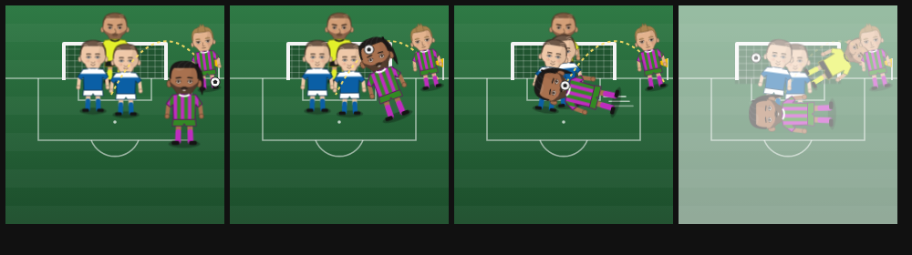

# 🐟 Új skill: Csukafejes (3.9.327)

## A kérés

> „Csukafejes — megnöveli a sima gólszerzési esélyt enyhébben, mint bármelyik
> másik csatár képesség, ami gólszerzési esélyt ad. De: szögletből gól
> esélyt az egész csapatra megnöveli, saját szögletből gól fejes esélye a
> többiekhez képest: +50%, és ha van a csapatban tökéletes beadás játékos,
> akkor együtt a gólszerzési esélyük +8%, ha pedig van köztük bármilyen
> kémia, az is ad rá: pár: +15%, passz: +10%, gyilkos: +7%, szárny: +12%.
> Legyen hozzá special animáció, feed kommentár, stb. Ami csak kell"

## A skill

`fw_header`, **csatár-skill**, a sima jutalom-pörgetésből is jöhet.

Minden hatás a skill **haladásával arányos**, ahogy a tökéletes beadásnál:
egy félig megtanult skill fele annyit ad.

| Hatás | Mérték |
|---|---|
| sima gólszerzés (goalw) | ×1,4 — a legenyhébb a csatár-skillek közt (eddig a Húzd meg a szélét! ×1,55-je volt a legkisebb); a játék globális goalw-skálázása mindegyikre ugyanúgy hat, a sorrend marad |
| **az egész csapat**, amíg pályán van: gólvárhatóság | ×1,03 („Csukafejes — veszélyes szögletek") |
| **az egész csapat**: a szögletből eső gólok aránya | ×1,3 |
| szögletgólnál a fejelők közül ő | ×1,5 |
| **duó** a tökéletes beadással (mindketten pályán) | a gólszerzési súlya +8% |
| + párkémia köztük | +15% |
| + passzkémia | +10% |
| + gyilkos páros | +7% |
| + szárny | +12% |

**Hogyan értelmeztem a két nyitott pontot:**

1. **„Szögletből gól esélyt az egész csapatra megnöveli":** két része van.
   * **Valódi többletgól:** a csapat gólvárhatósága +3%, mert a szögletek
     veszélyesebbek.
   * **Arány:** a gólok nagyobb része esik szögletből.

   A meccs-magyarázat (az edző elemzése) ezt néven nevezi.

2. **„Együtt a gólszerzési esélyük":** a duónak szól, nem a csapat
   gólvárhatóságának.
   * **Gólszerzés:** a csukafejes gólszerzési súlya nő (+8% + a kémiák,
     legfeljebb +52%).
   * **Gólpassz:** az ő góljainál a gólpasszt arányosan nagyobb eséllyel a
     tökéletes beadás birtokosa adja (35% × (1 + a duó bónusza), legfeljebb
     85%).

   A kettő együtt adja a „beadás → csukafejes" gólokat.

**Hatókör:**
* **Kiállítva** nem hat.
* **Skill nélkül** minden szorzó pontosan 1, tehát a motor betűre a régi.

## A közvetítés

A gólnál saját sorok jönnek, a régi „— érződött a rutin" helyett:

* **Szögletgólnál:**
  > 🐟 CSUKAFEJES! X vetődve, a levegőben fekve csúsztatta a szögletet a
  > hálóba!
* **Duó-gólnál:**
  > 🐟 Y beadása, X csukafejese — ezt már százszor gyakorolták — párkémia +
  > gyilkos páros + szárny: vakon is tudják, hova érkezik!

  A kémiák név szerint szerepelnek benne.
* **Egyéb fejesgólnál:**
  > 🐟 X egy beívelt labdára vetődött, és csukafejessel vágta be!

## A jelenet

**CSUKAFEJES!** „Vetődve, fejjel!"

1. A szögletzászlótól ívelt labda a kirajzolt röppályán érkezik.
2. A fejelő nekifut, elrugaszkodik, és **vízszintesen, fejjel előre**
   bevetődik a labda elé, sebességcsíkokkal.
3. A labda a kapuba csapódik, a kapus elvetődik, a háló megrezdül.

## Próba

`tools/csukafejes-3-9-327-proba.js`:

* **a skill:** csatár, goalw, a legenyhébb, pörgethető;
* **a szorzók:**
  * skill nélkül mind 1;
  * vele λ ×1,03, arány ×1,3, szögletnél ×1,5;
  * kiállítva nem hat;
* **a duó:**
  * +8%, a négy kémiával +15/+10/+7/+12%, névvel;
  * félig megtanulva fele hatás;
* **valódi meccseken:** a meccs-magyarázat néven nevezi, és a közvetítés-sor
  megszólal;
* **a jelenet:** a felirat, és a gól a jelenetéhez kötve;
* **oldalhibák.**

**Az igazított régi próba:** az `esemeny-animacio-3-9-270` most 27
skill-jelenetet számol.
