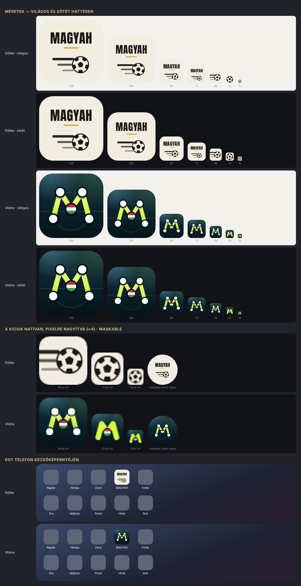

# 1.0.11.2.01 — Az új alkalmazás-ikon: a taktikai M

Forrás: `tools/ikon/rajz.js` (az egyetlen rajz), gyártó és ellenőrző:
`tools/ikon/general.js`, összevetés: `tools/ikon/osszevet.js`.

## A kérés

> „Tervezz új ikont, amely jobban tükrözi, mi ez a játék: magyar,
> futballmenedzser, taktika és kémia, „hibátlan idény” … már kis méretben
> (48 px, favicon) is felismerhető, és egy telefon kezdőképernyőjén kitűnjön.”

## Az ötlet

**Az M öt töréspontja öt játékos a taktikai táblán, a szárai a köztük futó
passz- és kémia-vonalak.** Egyetlen jel mondja el, hogy ez a MAGYAH, hogy
felállásról és összekötött játékosokról szól. A középső játékos a
**csapatkapitány**: piros–fehér–zöld karszalag-csíkos pont — a magyar szál, a
jel közepén. Az alap a Reflektor téma petróleum-éjszakája, bal felülről
reflektorfénnyel és a kezdőkör halvány ívével; a jel volt-sárga, a pontok
fehérek, sötét gyűrűvel kivágva a vonalból (így kis méretben is külön folt
marad mindegyik).

**Elvetett irányok.**

- *Focilabda* (a régi ikon): klipart, és semmit nem mond arról, hogy ez
  menedzser-játék.
- *„30–0” számokkal:* 48 px-en olvashatatlan.
- *Címerpajzs:* minden klubos alkalmazás ilyen.
- *Felirat az ikonon:* 72 px alatt egy hétbetűs szó olvashatatlan folt;
  fölötte pedig a jel maga a név.
- *Nemzeti szalag a jel alatt* (az első változatom): a két felső ponttal
  együtt arcnak olvasott („szem” és „száj”) — ezért került a kapitányra.
- *Blenderrel renderelt, plasztikus jel:* kis méretben a fény-árnyék elmossa
  az élt, és a készlet forrása kettéválna. A mélységet egy árnyék-vonal adja,
  ugyanabból az SVG-ből.

## A változatok

| Méret | Változat | Mi van rajta |
|---|---|---|
| ≥ 72 px | `teljes` | a jel árnyékkal, kezdőkör-ív, reflektorfény |
| 48 px | `mini` | ív és árnyék nélkül, vastagabb vonal |
| ≤ 32 px | `apro` | csak a kövér M és a kapitány — pontok nélkül (×4 nagyítással mérve: a négy fehér pont 32 és 16 px-en a sarkokba nyomódott, és elmosta az M-et) |
| 192, 512 | `maskable` | teljes széltében az alap, a jel a középső 80%-os körben |

A fájlnevek és méretek ugyanazok, mint eddig (19 fájl). A régi készlet és a
régi rajz a `tools/ikon/regi/` alatt maradt (összevetéshez, és ahogy a kérés
szólt: az új, ellenőrzött készlet átvételéig ne törlődjön).

## A gyártás és az ellenőrzés

`node tools/ikon/general.js`:

1. a rajzot Chromiumban rendereli minden méretre;
2. **tömörít**: a ≥72 px-es lapok `pngquant`-tal (minőség 88–100, árnyalás-
   simítással) palettásodnak, majd minden PNG `optipng -o5 -fix`-szel
   veszteségmentesen tömörül. A 16–48-as lapok nem palettásodnak. Ha az
   eszközök hiányoznak (`apt-get install pngquant optipng`), a lépés kimarad,
   és a gyártó szól;
3. **ellenőriz** (új): minden PNG pontosan a nevében álló méretű; a
   lekerekített ikonok sarka átlátszó, a közepük nem; a maskable teljes
   széltében kitöltött, és a jel egyetlen pixele sem esik a középső 80%-os
   körön kívülre; a `favicon.ico` 16 + 32 + 48 px-et tartalmaz.

| | előtte | utána |
|---|---|---|
| a 19 ikonfájl együtt | 126 kB | 193 kB (az 512-es nyersen 100 kB lett volna, tömörítve 33 kB) |

## Ami még vele változott

- `icons/site.webmanifest`: `theme_color` és `background_color` `#000000` →
  `#06141a` (az ikon és az alapértelmezett téma alapja); a képernyőképek
  feliratai a mai képekhez igazítva.
- A `<meta name="theme-color">` kiinduló értéke már az 1.0.11.1.00 óta
  `#06141a`, a `<head>` szkriptje témánként állítja.
- `sw-1.js`: `CACHE_NAME` v9 → **v10** (a statikus ág cache-first: e nélkül
  a régi telepítéseken a régi ikon maradna).
- `icons/play/feature-1024x500.png`: újrarajzolva az új arculatban
  (`tools/grafika/feature-graphic.html`: reflektorok, pálya, a cím ferde
  közvetítés-sávon, Exo 2, az új ikon; a szöveg a régi). A régi a
  `tools/ikon/regi/` alatt.
- `icons/screenshots/`: újra elkészítve. A `tools/kepernyokepek.js` a 3.9-es
  kezdőlap „Egyedül játszom” gombját kereste, ami azóta megszűnt — mind a
  négy kép a kezdőlap lett volna, a manifest képei pedig a 3.9.09-es
  állapotot mutatták. Átírva: kezdőlap, karrier-indítás, a HUB, élő meccs.

## Miért patch

A verziózási lap szerint új, látható rendszer = minor. Az ikon nem új
rendszer és nem új funkció, hanem a megnyitás (1.0.11.2.00) csomagjának
folytatása: ugyanaz az első benyomás, amit a nyitóképernyő kezd. Ezért
patch: 1.0.11.2.01.

## 1.0.11.4.02 — „újra telepítettem, és az ikon nem változott meg”

**Az ok.** Az új ikonok a **régi fájlnevekre** kerültek (`icon-192x192.png`
stb.). Minden gyorsítótár a fájl **címe** alapján dönti el, hogy van-e már
ilyen ikonja: a régi service worker (az ikonokat „előbb a gyorsítótárból”
adja, amíg az új worker át nem veszi a helyét), a böngésző saját tára, az iOS
ikon-tára és az Android telepítője. Ugyanazon a címen bármelyik visszaadhatta
a régit — egy újratelepítés is a már eltárolt ikont kaphatta.

**A javítás.** Minden ikon-hivatkozás verzió-utótagot visel (`?v=2`): a
manifestben (ikonok és képernyőképek), az `index.html` `<head>`-jében (favicon,
apple-touch) és a service worker előtöltési listájában (az értesítés ikonjai
is). Új cím = új kérés mindenhol. A `CACHE_NAME` v10 → v11. **A manifest címe
változatlan**, mert az azonosítja a már telepített alkalmazást — ha az
változna, a telefon új alkalmazásnak tekinthetné.

A `tools/ikon-1-0-11-2-01-proba.js` méri, hogy a három helyen ugyanaz a
verzió áll, és a manifest címe utótag nélküli. **Ha az ikon újra változik**,
a `?v=` mindhárom helyen együtt lépjen.

**Ami a telefonon a javítás után is kellhet:** a változásnak élesbe kell
kerülnie (a fő ágba), utána a játékot egyszer a böngészőben megnyitni, hogy az
új service worker átvegye a helyét. Android: a telepített alkalmazás ikonját a
Chrome a következő indításkor frissítheti (néha megerősítést kér); ha nem,
eltávolítás és újratelepítés. iOS: törlés a kezdőképernyőről, majd újra
„Hozzáadás a főképernyőhöz”. **A webhely adatainak törlése nem kell, és nem is
ajánlott — az a mentett karriert is törli.**
