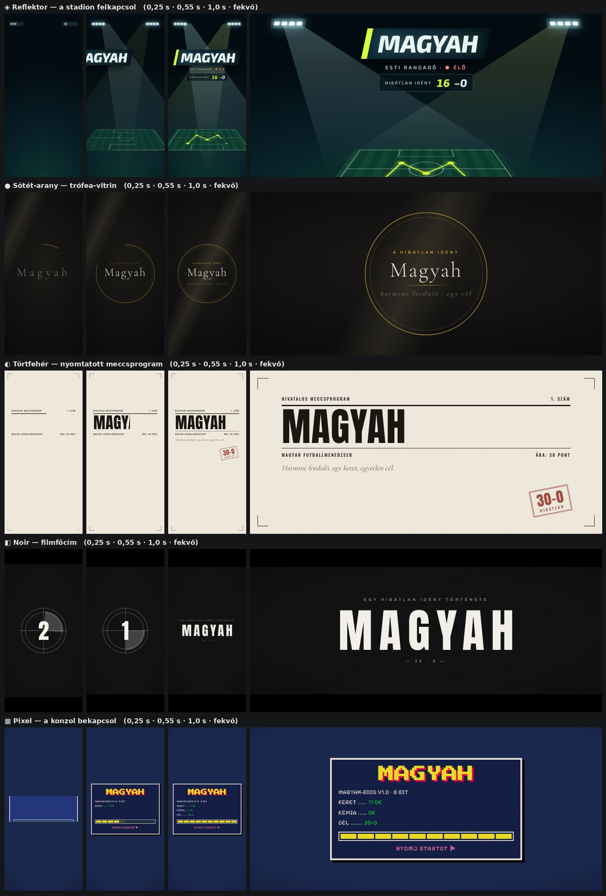

# 1.0.11.2.00 — 🎬 A nyitóképernyő, mind az öt témában más

Próba: `tools/nyito-1-0-11-2-00-proba.js`.

## A kérés

> „Készíts egy nyitó (splash) töltőképernyőt, amely a játék megnyitásakor jön
> be, a kezdőlap előtt … Mind az 5 témában más … Ne lassítsd a betöltést …
> Visszatérő megnyitásnál legyen visszafogott … A „kevesebb mozgás”
> beállításnál mozgás nélkül jelenjen meg.”

## Az öt képernyő

| Téma | Ötlet | Mozgás |
|---|---|---|
| ◈ Reflektor | A stadion felkapcsol | Két reflektorsor lámpánként gyullad, a fénykúpok bevilágítanak, a gyep vonalai perspektívában kirajzolódnak, a „MAGYAH” ferde közvetítés-sávon úszik be, a kezdőkörön a taktikai M öt játékosa és a köztük futó kémia-vonal áll össze. Alul a **„HIBÁTLAN IDÉNY 0–0” számláló valódi töltésjelző**: lassuló ütemben 29-ig megy, a 30. győzelmet a játék tényleges betöltése adja. |
| ● Sötét-arany | Trófea-vitrin | Vékony arany gyűrű rajzolódik körbe, a ritkított antikva cím összehúzódik, hajszálvonal nyílik, egy csillanás fut át. Csendes, lassú. |
| ◐ Törtfehér | Nyomtatott meccsprogram | Vágójelek a sarkokban, fejléc-léniák, a cím lépcsőzetesen „nyomódik” a papírra, végül egy ferde piros gumibélyegző csap le: „30–0 HIBÁTLAN”. |
| ◧ Noir | Filmfőcím | Szélesvásznú sávok, 3-2-1 film-visszaszámláló söprő mutatóval, aztán a címkártya, filmszemcse és halk vibrálás. |
| ▦ Pixel | A konzol bekapcsol | Képcső-bekapcsolás, gépelt rendszersorok („KERET … 11 OK”, „KÉMIA … OK”, „CÉL … 30-0”), blokkos töltősáv, villogó „NYOMJ STARTOT ▶”. Lépcsős mozgás. |

Mind kódból készül (HTML + CSS + egy kis SVG), kép és külső kérés nélkül. Az
öt együtt 23,3 kB.

## A keret és a betöltési logika

- **A `<body>` legelső eleme.** A témát a `<head>` szkriptje már az első
  festés előtt beállította, tehát a nyitó a jó témában jelenik meg, villanás
  nélkül. Csak a mentett téma képernyője épül fel a DOM-ban.
- **A téma címbetűje előre kérve.** A `<head>` szkriptje egy `preload`-dal
  kéri az aktív téma címbetűjének latin szeletét (saját szerverről), hogy a
  nyitó felirata ne a pótbetűvel villanjon fel.
- **Nem mesterséges várakozás.** A nyitó addig marad, amíg a nagy szkript és a
  mentés be nem tölt (a `initSaveSystem()` után jön a `nyitoKesz()`), de
  legalább 1,2 mp-ig első megnyitáskor, 0,5 mp-ig visszatérőként és 0,6 mp-ig
  „kevesebb mozgás” mellett — a navigáció kezdetétől számítva. Ha a minimum
  már letelt, a jelzés pillanatában tűnik el (egy `setTimeout` a betöltés
  utáni feladatok mögé sorolódott volna: mérve +0,6 mp lassú telefonon).
- **Koppintásra azonnal eltűnik**, és a koppintás nem jut át a kezdőlapra.
- **Biztonsági idő:** ha a jelzés valamiért nem jön, 6 mp után magától eltűnik.
- **Visszatérő megnyitás:** a koreográfia 0,42 mp-be sűrűsödik (minden elem
  egyszerre, késleltetés nélkül), a Noir visszaszámlálója kimarad.
- **„Kevesebb mozgás”:** minden animáció „backwards” kitöltésű, és az elemek
  alap-stílusa a végállapot, tehát a mozgás kikapcsolásakor a kész kép marad;
  átmenet nélkül tűnik el. (A játéknak nincs saját „kevesebb mozgás”
  kapcsolója; a rendszerbeállítást követi.)
- **Hang:** nincs. A nyitó nem nyit hangkártyát (a próba számolja).

## Mérés: lassítja-e a betöltést

Lassított hálózaton (20 Mbit/s, 60 ms) és 4× lassított CPU-n, mentett téma
nélkül, háromszor: a Karrier-gomb az oldalon belül mérve előtte átlagosan
6,25 mp, utána 6,36 mp múlva koppintható (a szórás ±0,35 mp); a `load`
eseménye ugyanott van. A nyitó a ~4–6 mp-es letöltés alatt végig mozog. Gyors
gépen (betöltés < 1,2 mp) az első megnyitáskor a minimum legfeljebb ~0,35 mp-et
ad hozzá — ez a kért „bemutatkozás”; visszatérőként (0,5 mp) semmit.

**Két hibát a mérés fogott meg, mindkettő javítva, mielőtt a commitba került:**

1. Először a nyitó alatt szüneteltettem a kezdőlap belépő animációit, hogy a
   kezdőlap a nyitó után mutatkozzon be. Lassú betöltésnél ez azt jelentette,
   hogy a nyitó után még 1–2 mp-ig úsztak be az elemek. Kivettem: a kezdőlap a
   nyitó mögött elkészül.
2. A Reflektor téma „új oldal beúszik” animációja (1.0.11.1.00) a betöltéskor
   látható kezdőlapon is lefutott, és a vágása 0,1–0,5 mp-ig takarta a
   Karrier-gombot. Most a nyitó a „kész” jelzéskor megjelöli a látható
   nézeteket (`data-elso`); a jelző elemenként kerül le, amikor az a nézet
   elrejtődik. Egy korábbi, globális kapcsolós változat az első koppintáskor
   indította el a beúszást, és az elnyelte a koppintást — ezt a
   `verziotortenet` próba fogta meg, a nyitó-próba 5b pontja őrzi.

## Méret

`index.html`: 9 501 167 → 9 525 889 B (**+24,7 kB**; ebből a nyitó blokkja
23,3 kB, a többi a betű-előtöltés és a jelzés). Egy képernyő átlagosan
~4,7 kB, mind a 100 kB-os keret alatt.

## A régi próbák

A `verziotortenet-1-0-4-10-00` a cache-nevet pontosan „v8”-nak várta; az
1.0.11.1.00 óta v9 (új betűk). A feltétel „v8 vagy későbbi”, ahogy a
pixel-tema próbában.
