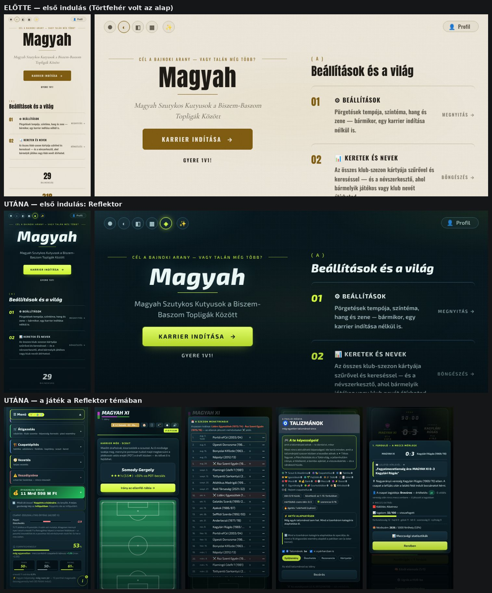
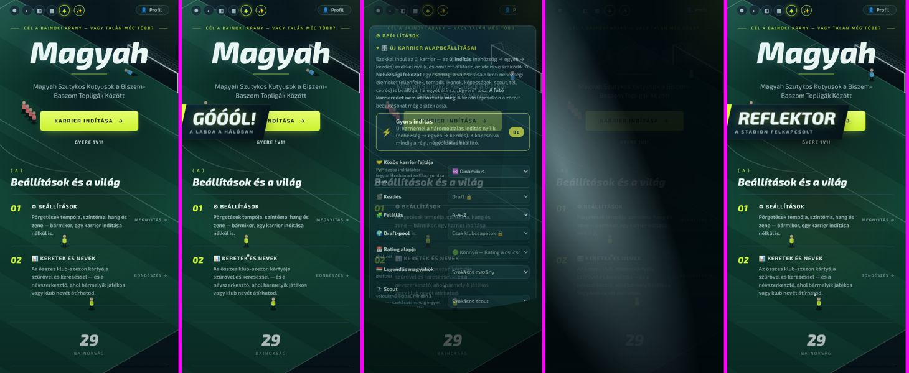

# 1.0.11.1.00 — ◈ Reflektor: az ötödik téma, és az új alapértelmezett

A terv és az elvetett irányok: [tema-reflektor-terv-1-0-11-1-00.md](tema-reflektor-terv-1-0-11-1-00.md).
Próba: `tools/reflektor-tema-1-0-11-1-00-proba.js`.

## A kérés

> „Tervezz és építs egy új, ötödik megjelenési témát … messze áll a meglévő
> négytől” · „Az új alapértelmezett téma legyen az új, általad készített
> téma.” · „Figyelj arra, hogy az egyes témáknak saját zenei témái is vannak.”
> · „Menő lenne, ha lennének saját gomb animációi, megjelenési, oldal
> megnyitási, ablakmegnyitási, és mindenféle egyéb izgi animációk ebben az új
> témacsomagban.”

## Mi ez a téma

**Esti rangadó a reflektorfényben, élő közvetítés.** A négy elődje egy-egy
*tárgy* világa (trófea-vitrin, nyomtatott program, filmnyomat, konzol); a
Reflektor maga a meccsnap: kivilágított stadion este és a tévéközvetítés
grafikája.

| Elem | Döntés |
|---|---|
| Alap | petróleum-éjszaka `#06141a`, panelek `#0c1f27` / `#132a34` |
| Kiemelés | „volt” `#d6ff3f` (a stoplisok neonja); jó = menta `#3ee08f`, rossz = korall `#ff8080`, info = égkék `#62c4ff` |
| Kontraszt | mind a 13 szövegszín ≥ 5,5:1 az alapon és mindkét panelen (a WCAG AA 4,5:1) |
| Szövegbetű | Exo 2 (OFL), változó súlyú, latin + latin-ext, 72 kB |
| Címbetű | „Exo 2 Cim”: az Exo 2 valódi kurzív 800-as példánya, szűkített jelkészlettel, 22 kB (`tools/reflektor/betu.py`) |
| Forma | üveges, átlósan színezett panel fény-éllel; világító volt-gomb sötét felirattal; döntött címek; a fejléc alatt volt→zöld közvetítés-vonal |
| Hangulat-réteg | két hideg fénykúp a felső sarkokból, álló kép |
| Eredményjelző | a bajnoki tábla petróleum-acél dobozt kap világos krónika-sávval; a kupák és a rangadó táblái a saját arculatukban maradnak |
| Élő háttér | éjszakai gyep, volt mezek, korall ellenfél, égkék kapus |
| Böngészősáv | `#06141a` (a `<head>` és az `applyTheme` `SZIN`-térképében, és a `<meta>` kiinduló értéke is ez) |

**Miért kellett külön címbetű-fájl.** A felület a `--font-disp`-et mindenhol
400-as súllyal kéri, mert a többi téma címbetűje (Archivo Black, Anton) eleve
kövér, egysúlyú fájl. A változó Exo 2 ugyanerre a kérésre a vékony 400-at adná.
Több száz szabály átírása helyett a címbetű itt is rögzített súlyú fájl; mivel
maga a fájl dőlt, a böngészőnek nem kell hamisan döntenie.

**Ahol a téma saját szabályt kapott** (a fájl végén, „A REFLEKTOR TÉMA
FORMÁJA” blokk): panelek, gombok, fejléc, a világos kiemelőszíneken a sötét
betű (posztjelvények, kiválasztott opció; fehérrel ezek 1,6–1,8:1 lettek
volna), az eredményjelző, a serif (Cormorant) helyett a téma betűje a
kezdőlapon és az ünneplés-címben, és a fejléc vezérlőinek sortörése 420 px
alatt (az Exo 2 számjegyei szélesebbek; mérve 390 px-en 427 px-re tolta volna
a sort).

## Saját zene: „Esti rangadó”

A többi lágy hangulat (Mozi, Napos, Füstös jazz) ugyanazt a három kottát
hangszereli át. A Reflektor, mivel ez az első zene, amit egy új játékos hall,
**saját dallamokat** kapott (`HANG_DALOK_ESTE`): főcím (D-dúr, kvart-ugrásos
induló), taktika (e-moll, nyugodt), meccsnap (A-dúr, futó nyolcadok). Saját
szerzemények. A hangszerelés: elektromos zongora, pad, mély szinusz-basszus
alaphang–kvint lépéssel, egyenletes puha lábdob peremütéssel. A hangulat a
`F.dal` mezővel kéri a saját kottát (`hangLagyDal`); a másik három hangulat
változatlanul a közöset kapja. A hangereje a többiével 3 dB-en belül van
(a próba offline hangkártyán méri).

## Saját animációk

A nyelv a közvetítés grafikája: ami megjelenik, az beúszik, ami megnyílik,
azt egy reflektor világítja be, ami lenyomódik, az felvillan.

| Mozgás | Mi történik |
|---|---|
| Gombok | rámutatásra / fókuszra fénycsík fut át; lenyomásra összehúzódnak és felizzanak; a koppintás helyén volt-gyűrű nyílik; a fő gombon 7 mp-enként magától átfut egy csillanás |
| Új oldal | a szakasz ferde vágással beúszik (0,52 mp) |
| Ablak | fénykör nyílik felülről, a lap felizzik, a háttér elsötétül (0,5 mp) |
| Menü | a csoportok 40 ms-os lépcsővel emelkednek be; a lenyitott csoport tartalma beúszik |
| Kezdőlap | a „Magyah” cím élesedik és összehúzódik, mint egy főcím |
| Meccs | gól, kapott gól, mesterhármas, piros lap, lefújás: „alsó harmad” felirat a közvetítésből; gólnál az eredményjelző felvillan |
| Témaváltás | a Reflektorra váltva „felkapcsol a stadion”: sötét lap, két fénykúp gyullad, majd elhalványul |

**Fegyelem.** Mind az élő háttér kapcsolóján (✨) ül, és minden CSS-szabály a
`prefers-reduced-motion: no-preference` feltétel alatt van: ha a rendszer
kevesebb mozgást kér, akkor is nyugton marad, ha a ✨-et kézzel bekapcsolták.
A belépő animációk `backwards` kitöltésűek: a végállapot (vágás, szűrő) nem
marad az elemen, tehát a fix pozíciójú gyerekeket nem zavarja (a 3.9.205-ös
pixel-hiba tanulsága). Folyamatosan futó, teljes képernyős animáció nincs; a
JS-effektek (gyűrű, felirat, felkapcsolás) pointer-events nélküliek, és
egyszerre legfeljebb három gyűrű él. A gól-felirat a meccs esemény-animációja
alatt rejtve marad, mint a Pixel arcade-felirata.

## Az alapértelmezés váltása

`DEFAULT_THEME` és a `<head>` `ALAP`-ja: `paper` → `reflektor`. Csak az **első**
indulásra hat: aki eddig játszott, annak az `applyTheme` már elmentette a
látott témát (`theme30_0`), tehát nála semmi nem változik. A megszűnt témák
mentett értéke (bordó stb.) mostantól a Reflektorra esik. A mentés és a PvP
nem érintett (a téma a `localStorage`-ban él).

## Amit a teljes próbakészlet talált, és a javítás

A 326 régi próbát lefuttattam a változtatás előtt és után. Előtte is 13 bukott
(régi, a témától független hibák). Utána négy új jelzés jött, mind kivizsgálva:

- **A Profil-gomb a ✨-re csúszott** hosszú becenévnél 320–375 px-en
  (`hatter-minden-tema-3-9-203`): a szélességkorlát négy témagombra volt
  méretezve. Az ötödikkel +30 px a tartalék. Javítva.
- **Fekvő módban a Csapatstílus lebegő panelje 34 px-re zsugorodott**
  (`fekvo-menu-tartalom-3-9-345`): a menücsoportok beemelkedő animációja
  `transform`-ot tett a csoportra, és az a fix panel viszonyítási dobozává
  vált. A mozgás a csoport címsorára került; a törzs, az ablak és az oldal
  animációja se `transform`-ot, se `filter`-t nem használ (a próba ezt is méri).
- **A Boost-központ fejléce 170 px fölött** (`boost-fejlec-1-0-9-8-02`): a mérce
  a keskeny betűs Törtfehérre készült, amikor az volt az alap. Mérve: Törtfehér
  155, Reflektor 187, Noir 187, Sötét-arany 204 px. A próba most a saját eredeti
  feltételéhez (Törtfehér) kötve mér; a mérce nem lazult.
- **A Pixel-próba az alapértelmezett „paper”-t várta** — a kérés szerint
  mostantól `reflektor`; a feltétel átírva.
- A `celres-tartos` és a `kispad-mester` egy-egy futásban bukott, de
  mindkét állapoton ismételve zöld: ingadozás, nem regresszió.

## Ami nem változott

A régi négy téma változói és betűi bitre a régiek (a próba 17 változót és a
két betűt méri témánként), a formablokk minden szabálya a Reflektor
szelektora vagy a saját effekt-elemei alatt áll, a négy téma hangja a régi.

## Méret és betöltés

| | előtte | utána |
|---|---|---|
| `index.html` | 9 472 711 B | 9 501 167 B (**+28,5 kB**: a téma CSS-e, a saját zene kottája, az animációk) |
| új betűfájlok (külön, lustán töltődnek, a service worker előre cache-eli) | — | 4 szelet, 93,9 kB |

A betűk csak Reflektor témában töltődnek le; a mostani alapértelmezett témában
ez az Oswald + Anton helyett jön, tehát az első indulás hálózati költsége
nagyságrendben ugyanaz. A `sw-1.js` `CACHE_NAME`-je v8 → v9.
